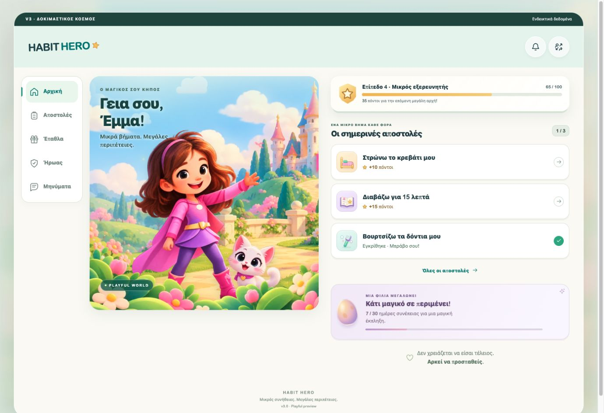
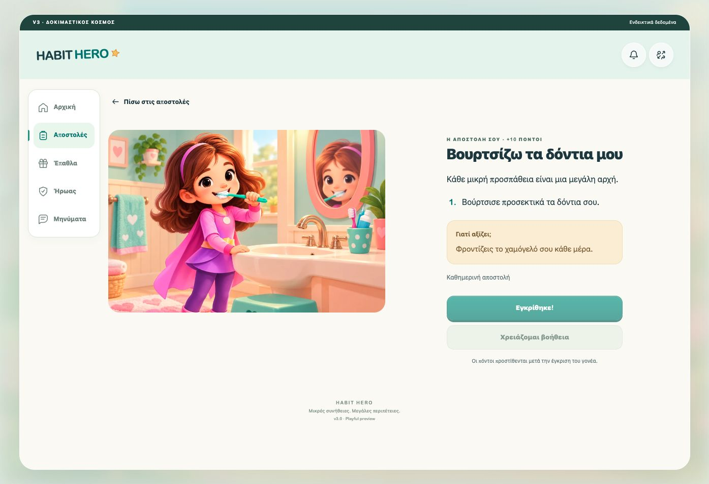

# Habit Hero 3.0 — Playful vertical slice

2026-10-17. First theme and child experience; the other themes and parent redesign have not been released.

## Open it

- Visual sandbox: `/habit-hero/v3/preview/` — clearly labelled example data. Help, submissions and reward requests simulate UI states only; no API writes.
- Existing-account version: `/habit-hero/v3/child/` — reads and writes through the existing child APIs. Unlock the child in the existing family screen; child selection now opens this v3 route. The parent workspace remains v2.
- Local: `node scripts/v3/preview.mjs`, then http://127.0.0.1:4173/habit-hero/v3/preview/.
- Phone composition review: http://127.0.0.1:4173/qa (development server only).

## The visual foundation

The supplied Habit Hero v3 Visual Implementation Blueprint is the visual reference. Playful has a sunny pastel garden kingdom, mockup-based childlike hero and companion reconstructions, foreground flowers, warm paper cards, and five navigation destinations. Artwork is generated specifically for this world rather than using the v2 geometric SVG scenes.

Three independently composited illustrated planes establish the scene:

1. Distant castle, mountains, waterfalls and garden landscape.
2. Transparent hero and companion: the reference girl with her white kitten, or reference boy with his blue dragon. Both appearances are available to everyone.
3. Transparent flowers, foliage and rocks in front of the hero.

The near plants overlap the character; the character sits in front of the scenery. Atmospheric perspective and light give depth while still. Pointer movement shifts scenery and foreground opposite the hero, with the near plane moving most. Scrolling supplies parallax on touch devices without device-motion permissions. Supported touch devices also offer relative device-tilt parallax; iOS requests orientation permission only after tapping “Κίνηση με κλίση”. Reduced motion disables tilt. The sensor stream is ignored off Home and while hidden, values are clamped and smoothed, and axes follow screen rotation. Reduced motion disables decorative animation and layer transforms. Motion is frame-scheduled and transforms do not change layout. Background clouds drift continuously and daylight gently shifts; ambient motion pauses outside Home or while the page is hidden. Background pollen glints remain behind the characters. Heroes, foreground foliage and controls have no idle animation. There is no full-screen canvas or continuous JS animation loop.

`app/v3/worlds/playful.js` owns art mappings and depth coefficients; `worlds/playful.css` owns base palette/type tokens. The shared client owns navigation, data, and interaction behavior. Future worlds should supply original matching artwork and additional art direction; changing colors alone is insufficient.

Production WebP assets retain transparency and are self-hosted. Home's background, active hero and foreground together are approximately 292 KB. The second hero and task scenes load when used. No runtime AI service or per-image generation call is required for families.

## Working slice

- Home with actual mission statuses, level progress, and consistency-based companion progress when signed in.
- Colourful Playful SVG activity badges in the Home and mission lists, with larger illustrations reserved for focused mission detail.
- Separate mission list and focused mission detail, instructions, benefit, help and submit actions. Submission never grants immediate points.
- All-done state distinguishes waiting-for-approval from approved days.
- Rewards respect balance, backend previous-request state and parent review.
- Hero appearance choice remains local to this device, reusing the existing child preference key.
- Messages combine approval, reward and help events. Read state is per child in this browser's local storage, surviving reload. It is not yet synchronized across devices.
- Refresh on returning to the page and once per minute while visible. Failed loads expose retry; authenticated responses are not stored in a service-worker cache.
- Same-origin existing APIs retain all security, schedule, slot, cooldown and ledger authority. No database migration or API rewrite is introduced.
- Existing PWA identity and standalone display metadata, safe-area-aware tabs and install icons. Offline account use is not implemented in this slice.

## Focused verification

Use the existing routing, child-authorization and recurrence checks plus `node scripts/v3/check.mjs` for new routes and packaged assets. Review actual browser layouts at 320, 390, 430 and tablet widths, then one mission/help/submit journey. Do not rebuild the legacy Expo frontend repeatedly for visual edits.

The `cloudflare.yml` dispatch input `v3_preview=true` invokes the focused deployment workflow. It reuses the last successful main static artifact, overlays the current app, and deploys the current Worker. Legacy static routes are retained; no migrations run. The version endpoint reports `release_ref` and checks the deployed source branch, so a preview is not incorrectly offered the older main build as an update. Normal builds use `main`. An expired baseline fails explicitly and requires a full build. Normal main builds retain the original workflow.

Before calling the whole v3 product complete: verify a signed-in child → parent approval → updated balance journey on live test-family data; test an actual iPhone home-screen installation, VoiceOver, reduced motion and offline behavior. Complete and review the rest of the blueprint, including parent onboarding, scheduling UI, all character states and the other three worlds. A passing build or a visual sandbox is not proof of those flows.

## Preview verification record — 2026-10-17

- Browser reviewed the composed Home at 320, 390 and 430px, with tablet layout also available in the local review harness.
- Confirmed all three production illustrated planes loaded. Browser inspection measured different pointer transforms: landscape x=-2.665px, hero x=+4.797px, foreground x=-8.528px for the same pointer position.
- Verified the sandbox mission detail → help → submit → approval confirmation journey. Home updated from 1/3 to 2/3, and points remained unchanged.
- Opening Messages cleared its unread indicator; returning to the preview retained the read state.
- Existing Worker routing, child access/isolation and recurrence checks passed. V3 route and local asset checks passed in GitHub Actions.
- The additive Cloudflare deployment completed successfully using the previous static artifact; its built-in checks verified the deployed source SHA and D1 connection.
- No live family records were created or changed for this visual review. Real authenticated approval and actual iPhone installation remain unverified.

## Reference artwork correction — 2026-10-17

The first-preview mature art is replaced by reconstructions using the dedicated Girl Hero/Boy Hero cards and first Playful phone in the supplied PDF as direct references. These are close reconstructions, not pixel-identical original source assets. The girl keeps her pink outfit, purple leggings and kitten; the boy keeps his blue cape and little dragon. See [the art direction](PLAYFUL-ART-DIRECTION.md) and [reference prompts](PLAYFUL-REFERENCE-PROMPTS.md).

Activity rows now use shaded, colourful native SVG bed/toothbrush/book/outdoor badges instead of scene thumbnails. Browser inspection confirmed zero row images and three Playful icons in the sample Home. Clouds were confirmed running while Home was visible and paused after changing tabs; heroes and foreground had no idle animation. All scene images loaded successfully, and both hero choices were inspected in the browser.

## Device testing

Open the family entry point, sign in as the parent, create/select a child, and unlock that child to enter v3 with actual API data. On supported iPhones, tap “Κίνηση με κλίση” and grant the orientation prompt to test layer movement. On devices that do not require permission it activates automatically. Turning it off or enabling reduced motion stops tilt. Real-device sensor response remains for user testing; browser checks cannot verify physical hardware.

## Usability pass — preview.3

- Tilt preference is stored per device/browser. On page load the client attempts to reuse the browser's existing grant, and remembers an explicit off choice. If a retained grant still needs activation, it reconnects after a normal page gesture rather than requiring the dedicated button again. The browser controls whether consent is retained; the app cannot override a revoked grant or mandatory permission prompt.
- Scroll changes foreground/hero/background transforms at visibly different rates and closes a themed flower-and-leaf canopy; upward scrolling reverses it. Reduced motion removes the curtain and decorative transforms.
- Mission detail now shows the reference child actually making a bed, brushing teeth or reading. Lists keep their Playful SVG icons. Other custom missions use the existing coherent world/icon fallback.
- The switch icon opens profile selection without logging out first. Cancel/× returns to the current child; opening the picker and failed PINs preserve the child session. A successful switch revokes that session in the same transaction as the new unlock. Parent entry also clears the child cookie.
- Tablet screens use two scene/content columns. Desktop screens use a navigation rail and wider Home, rewards and mission-detail layouts. The mobile layout remains compact.
- The magic egg gently wobbles and glimmers. This is the requested exception to background-only idle animation; reduced motion disables it.

Focused verification includes automatic tilt reconnection/opt-out/denied-grant tests and profile cancellation/failed-PIN/verified-switch session tests. Browser inspection covered Cancel on the PIN form, the brushing illustration, the egg's animation, scroll-driven transforms, and layouts at 320/390/768/1280px with no horizontal overflow and valid navigation touch targets. Layout measurements are recorded in `screenshots/v3-responsive-check.json`.

### Parent workspace · preview.4

- `/habit-hero/v3/parent/` uses real parent APIs and the existing Google/PIN session; parent unlock and first-child entry now open this workspace.
- `/habit-hero/v3/parent-preview/` is a labelled, browser-memory-only sandbox. It imports isolated sample data and never sends mutations to the family API.
- Calm cream/sage layout, responsive navigation, family dashboard, child creation/editing, recent progress, custom missions, assignment changes, approvals and help replies, reward creation and redemption review, timezone and data export.
- The goal picker is now native to v3 (preview.6); the legacy administration link remains as a fallback. PIN/device controls, point adjustments, reward editing/assignment/archiving and mission archiving are now available directly in v3 (preview.5). Mission editing currently changes name, points and recurrence, matching the existing update API; detailed instructions are entered during creation. Weekday/time-window scheduling remains outside this release.
- No schema changes, new service or production-family test writes. Child scenery, tilt, scroll curtain and egg animations remain independent of the parent shell.

Parent validation: browser sandbox mission creation increased the mission count and approval/help replies updated the inbox, without real API writes. Browser console had no errors. Parent layouts inspected at 320px, 390px, 768px and desktop; 320px measured scroll width 305px and 768px measured 753px (15px scrollbar), with no document overflow. Phone navigation exposes all six destinations in two rows. Screenshot: `docs/screenshots/v3-parent-dashboard.png`. Real parent-account mutations were not exercised during visual QA.

### Parent management · preview.5

- Children: masked four-digit PIN reset with confirmation; device pairing with one-use ten-minute token; revoke all child devices and unused pairings with an explanatory confirmation; manual point adjustments using a stable request UUID per dialog (the existing server ledger prevents duplicate awards and negative balances).
- Rewards: edit name, description, cost and recurrence; assign/unassign children; archive without changing historical redemptions. Missions can also be archived. Archiving is not exposed as reversible in this interface; its confirmation says so.
- PIN and pairing fields are removed from the DOM when the dialog closes. Tokens never enter URLs or localStorage. Closing/cancelling is disabled while a write is pending. Pairing generation stays in the dialog to show the returned code.
- Consolidated verification: existing child-PIN, child-auth/pairing/revocation, family and habits checks passed. Browser sandbox verified reward cost update, archive cancellation, nested device panel navigation, pairing result/cancel, and insufficient/successful point adjustments. PIN fields inspected without changing real credentials; no real family writes performed. Child world and motion assets unchanged.

### Goals and suggestions · preview.6

- Missions and Settings open a 20-goal picker with a child selector. Suggestions contain editable title, instructions, benefit and normal schedule/points defaults; younger children get adult-support wording, older groups get planning/reflection wording.
- Suggestions never create missions automatically. “Προσαρμογή πρότασης” opens the existing builder and the normal server-authorized create action. Matching normalized titles already assigned to that child show an existing-assignment badge; this is a convenience check against loaded active missions, not a new database uniqueness guarantee. Custom names remain allowed.
- Goal selections are browser-local, keyed by the authenticated family ID. Legacy unscoped `hh2-family-goals` is deliberately not imported across households. The sample route does not persist goals. Storage failure is reported and selections continue in memory.
- Focus remains on the chosen goal after toggling; switching from suggestions to the builder moves focus to the dialog header and resets its scroll position.
- Focused checks cover 20 unique IDs, all three age groups, field limits, Greek capitalization/accent/whitespace normalization and child-specific matches. Browser sandbox checked duplicate notice and a suggestion through editor to saved mission, without production writes. No database migrations or artwork changes.

### Scheduling and history · preview.7

The existing `habits.frequency_days_json` stores a versioned object `{version:1,weekdays:[1..7],start:'HH:mm',end:'HH:mm'}`. Empty hours mean all day; null legacy values mean every day without a window. Nonempty hours require both values and start < end on the same day; closing time is exclusive. Invalid stored schedules fail closed. The family timezone determines both weekday and clock, including DST. No schema changes are introduced. Changing recurrence/schedule leaves historical submissions and ledger entries untouched.

Parent mission listing now includes all editable details, and updates preserve omitted fields for legacy callers. Child and supervised submission routes reject out-of-schedule requests. The child Today view excludes other-day missions; a separate filter exposes them, and detail views explain timing while keeping help available. Server validation remains authoritative when the clock changes while a page is open.

Child Hero exposes existing API milestone badges and recent attempts. Rewards expose request history. Paired children can lock a configured PIN and see an in-v3 unlock form; a PIN never becomes an independent remote login. Credential input is cleared after submission. Unlock/locking were not tested against a real family during visual QA.

Validation: focused schedule tests cover timezone/DST, start/end boundaries, malformed schedules, both submission gates and full update fields. Existing PIN roundtrip, child privilege/pairing, habits, supervised activity and 11 SQLite schema checks pass. The old SQLite fixture assumed a six-column parent table; it now names its original columns explicitly, allowing subsequent PIN columns to take defaults. Browser sandbox verified edited text/time/day persistence, calendar/history, badges, planned missions with disabled submission and local paired-PIN form rendering. No production test mutations. Screenshots are in `docs/screenshots/v3-progress-calendar.png`, `v3-scheduled-mission.png` and `v3-child-history.png`.

Remaining functional work and original-source comparisons are tracked in `docs/V3-FEATURE-PARITY.md`; v3 is not claimed to have full feature parity.

### Encouragement · preview.8

Parents can send a personal message to one child, optionally attaching 0–100 Love Credits. Zero is the default. A durable `family_messages` record is separate from both habits and manual corrections. The child sees it in Messages and explicitly claims any gift. Opening the inbox records a read receipt; gift claims are independent. Direct-message unread state uses the server receipt across devices; older help/approval notification read state remains browser-local.

Sending uses a stable per-dialog request UUID, unique per family. Claiming atomically inserts a `love_credit` ledger entry and updates receipt metadata via D1 batch. The ledger's unique `(family_id,child_id,idempotency_key)` constraint makes retries award exactly once, including after refresh. Gifts are added to balance/lifetime earned points without fabricating habit completions or streak days. There is no background push claim: messages refresh when the app is foregrounded/refreshed, following existing polling.

Migration `0007_family_messages.sql` is additive and uses existing family/child/parent foreign keys. The manually dispatched schema workflow runs offline integrity/transaction tests and refuses any unrelated pending legacy migration before applying it. Verify remote foreign keys and table presence, then deploy the Worker. Rollback is the prior Worker build; retain the additive table and any sent messages rather than dropping data. Family export includes body, gift amount and receipts, not authentication secrets.

Checks use actual in-memory SQLite for message SQL: send retry, deferred claim, duplicate claim, forced batch rollback, zero-point message, CSRF, parent/child privilege boundaries and cross-family access. Browser QA uses isolated sample data for composer/history and claim-to-disabled state. No messages or gifts are sent to real families as part of QA. Screenshots: `v3-parent-encouragement.png`, `v3-love-credits.png`.

Migration audit: the remote tracker predates several already-deployed legacy changes (timezone, PIN/household, help and slots). The normal migration guard stopped without replaying them. A `messages_only` manual mode checks those seven required schema components and points Wrangler at a temporary directory containing only `0007_family_messages.sql`. This records the new migration normally without replaying or marking legacy migrations as applied. No existing family records are altered.

### Message spacing and routines · preview.9

Message bodies use an explicit column layout with independent heading, body, timestamp and gift button rows. The button has at least a 48px target, a wrapping label and normal document flow. `docs/screenshots/v3-message-layout-check.json` records browser measurements at 320/390/768/1280px: no text/time intersection and no horizontal document overflow. `v3-message-spacing-fixed.png` is the corrected screenshot.

Parents can assign a mission to morning, after-school or bedtime, with step order 1–50. This optional metadata lives in the existing versioned schedule JSON (`routine`, `order`) and is returned by the child API; no migration is needed. Routine configuration belongs to the mission, so shared missions share their routine/order. This first routine model uses three common groups, not arbitrary custom routines.

Children see submitted/total progress, choose a routine, and continue to the next available step after submitting. This is supportive ordering, not a mandatory task gate. Points still require normal parent approval. The next-step helper skips other-day, waiting and submitted attempts. Server activity availability now explains missing prior repetition, cooldown, family-local next-day spacing and rejected attempts (which still require parent guidance under the existing occurrence rule).

Checks: focused routine ordering/filter/availability tests and existing scheduling/auth checks passed. Browser sandbox verified parent routine assignment and displayed step order, child first-step submission → next mission, and updated 1/2 progress. No production family mutations. Screenshots include `v3-routine-progress.png`. Background artwork and depth effects were not changed.
